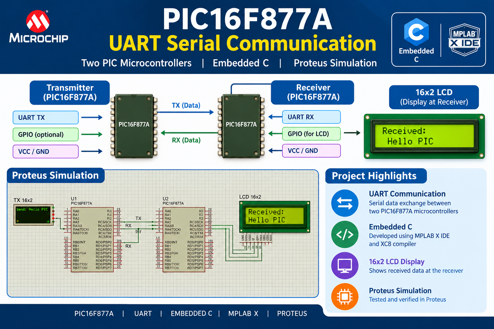
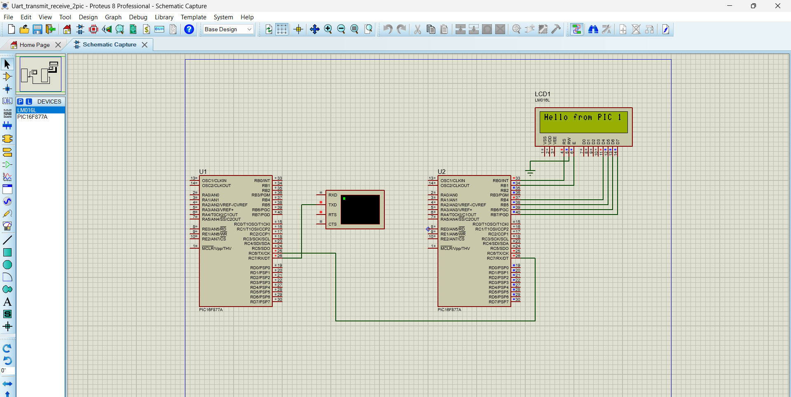

# PIC-to-PIC UART Serial Communication




## 📌 Project Overview

This project demonstrates UART serial communication between two PIC16F877A microcontrollers using Embedded C. The transmitter sends serial data to the receiver, and the receiver displays the received information on a 16×2 LCD.

The complete system is simulated using Proteus.

## 🛠️ Hardware and Software

* **Microcontroller:** PIC16F877A (Transmitter and Receiver)
* **Programming Language:** Embedded C
* **Compiler:** MPLAB XC8
* **IDE:** MPLAB X IDE
* **Communication Protocol:** UART Serial Communication
* **Display:** 16×2 LCD
* **Simulation Software:** Proteus Design Suite

## ⚙️ How It Works

1. The transmitter PIC16F877A sends data through its UART TX pin.
2. The receiver PIC16F877A receives the data through its UART RX pin.
3. The receiver processes the incoming serial data.
4. The received information is displayed on the 16×2 LCD.
5. The communication system is tested through Proteus simulation.

## 🔌 System Architecture

```text
   PIC16F877A                 PIC16F877A
   TRANSMITTER                 RECEIVER
  +------------+             +------------+
  |            |    UART     |            |
  |   UART TX  | ----------> |   UART RX  |
  |            |             |            |
  +------------+             +------------+
                                    |
                                    |
                               +---------+
                               | 16x2 LCD|
                               +---------+
```

## 📂 Project Structure

```text
PIC_to_PIC_UART/
│
├── README.md
├── Transmitter/
│   └── transmitter.c
├── Receiver/
│   └── receiver.c
├── Proteus/
│   └── Proteus_Simulation.dsn
└── Images/
    ├── project_thumbnail.png
    └── Proteus_Simulation.png
```

*Note: Replace the example filenames with your actual filenames if they differ.*

## 🖥️ Proteus Simulation

The project was simulated in Proteus to test serial communication between the two PIC16F877A microcontrollers.


## 🎯 Key Learning Outcomes

* Configuring UART transmitter and receiver peripherals.
* Understanding serial communication between two microcontrollers.
* Setting the UART baud rate and communication parameters.
* Interfacing a 16×2 LCD with a PIC16F877A.
* Writing Embedded C firmware using MPLAB X IDE and XC8.
* Testing embedded systems using Proteus simulation.

## 👨‍💻 Applications

* Microcontroller-to-microcontroller communication.
* Embedded system data exchange.
* Serial communication experiments.
* Learning UART peripheral configuration.

## 📌 Project Status

Completed and simulated in Proteus.

## 👤 Author

**Sabari K**

GitHub: [sabarikumar2004](https://github.com/sabarikumar2004)
